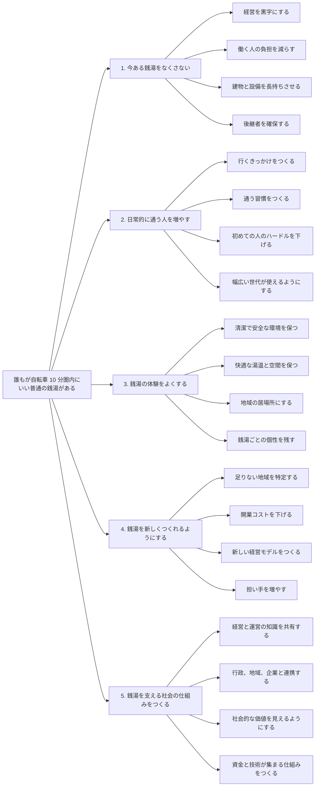

# 普通の銭湯研究所（仮）

日本中の誰もが、自転車で 10 分以内に、いい普通の銭湯に行ける世界をつくる。

銭湯を盛り上げたいわけでも、おしゃれな銭湯を増やしたいわけでもありません。最新の技術が裏側で支えることで、普通の銭湯が普通の銭湯のままでいられるようにしたい。そのための方法をデザインとテクノロジーで調べ、実際につくり、だれでも使える形で公開していく場所です。

まだ現場の話を聞く前の仮説です。ここに書いてあることは、銭湯の人に会うたびに書き直します。

## いい普通の銭湯とは

特別な日のレジャー施設ではなく、日常的に通えて、気持ちよく過ごせて、地域に長くあり続ける銭湯のことだと、いまは仮に置いています。

## 全体像

新しい銭湯を建てるだけでは足りません。銭湯がなくなる速さを下げることと、銭湯をつくれる速さを上げることの両方が要ります。

## 前提にしている課題

利用者が減っていること、設備が古くなっていること、燃料費が上がっていること、家族経営で労働時間が長いこと、後継者がいないこと。一般公衆浴場は入浴料金に上限があるので、値上げだけでは解決しにくい。

この整理は、厚生労働省の[浴場業の振興指針](https://www.mhlw.go.jp/bunya/kenkou/seikatsu-eisei05/12.html)（2025 年 3 月、厚生労働大臣決定）をもとにしています。本文との照らし合わせはこれからです。

## 中身

- [actions.md](actions.md): 5 つの枝ごとの、具体的にできそうなこと
- [projects.md](projects.md): プロジェクトの案 10 個と、どこから始めるかの比較
- [first-3-months.md](first-3-months.md): 最初の 3 か月でやること

## 何で測るか

アプリの利用者数や SNS のフォロワー数では測りません。

- 減らせた労働時間
- 減らせた経費
- 続けられた銭湯の数
- 自転車 10 分圏内で銭湯に行ける人の割合

全国に同じ密度で銭湯を置くことが経済的に成り立つのかは、まだわかりません。それもここで調べることの一つです。

## 決めていること

- カメラは機械室の計器などに限り、浴室と脱衣所では使わない
- 安全の管理で、AI は人の補助にとどめる
- 目的は AI を使うことではなく、銭湯の負担を減らすこと
